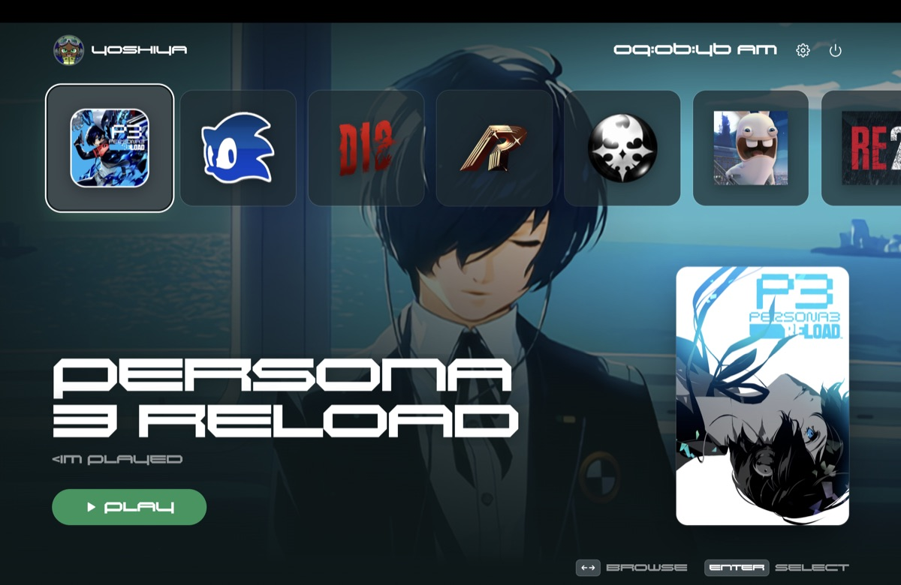
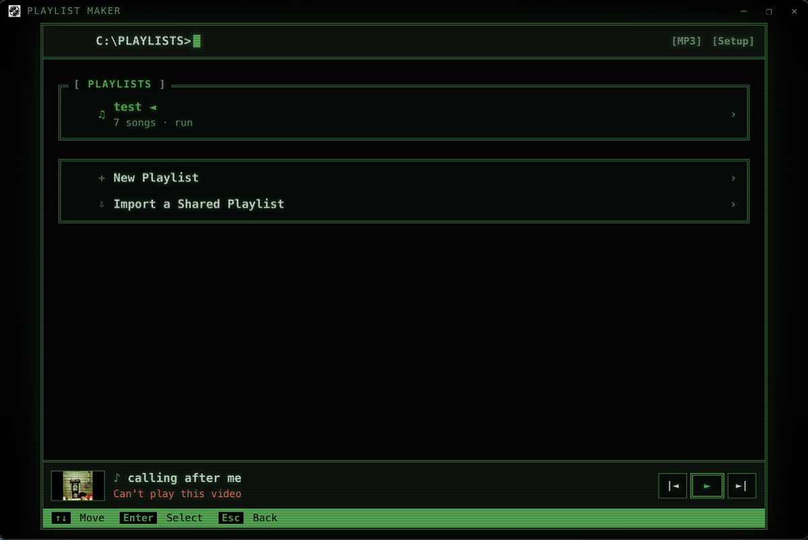

  

  

<table align="center">
  <tr>
    <td align="center">
      <h3>🌐 My Portfolio</h3>
      
Everything I've built, all in one place. Let's connect!

      
      
        
      
      
    </td>
  </tr>
</table>

## 👋 About Me

I'm just a guy who wants to learn the world of coding and make art with it.

- 🎓 **SWE Alum** of [The Marcy Lab School](https://www.marcylabschool.org/), building full-stack web development skills
- 🗽 Born and raised in **Staten Island**
- 💪 **Strengths:** Teamwork · Creative vision · Adaptive learning · Planning
- 🎮 Outside of code I play video games, edit video, and create 3D art
- 🚀 **Mission:** create a game people can love

## 🛠 Tech Stack

  

## 📌 Featured Projects

<table>
  <tr>
    <td width="50%" valign="top" align="center">
      <h3>🎮 Virtual Launcher</h3>
      
      
A console-style game launcher that turns your desktop games into a big-screen dashboard. Fully controller-operable, with custom cover art, themes, music, and menu sounds.

      
      
      
        
      
      
    </td>
    <td width="50%" valign="top" align="center">
      <h3>🎵 Playlist Maker</h3>
      
      
A retro, pocket-media-player style desktop app. Search YouTube, build playlists, and share them with friends as a code. Full keyboard and controller support.

      
      
      
        
      
      
    </td>
  </tr>
  <tr>
    <td colspan="2" valign="top" align="center">
      <h3>🕹️ The Totally Retro Arcade</h3>
      
      
A collection of classic retro arcade games built with vanilla JavaScript.

      
      
      
        
      
      
    </td>
  </tr>
</table>

  

